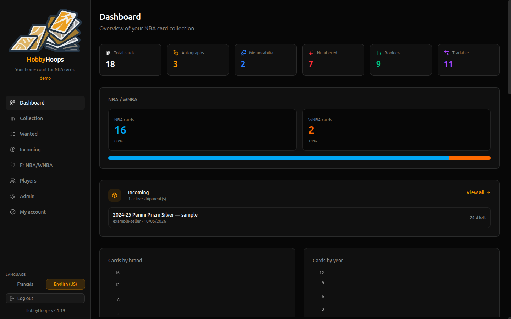
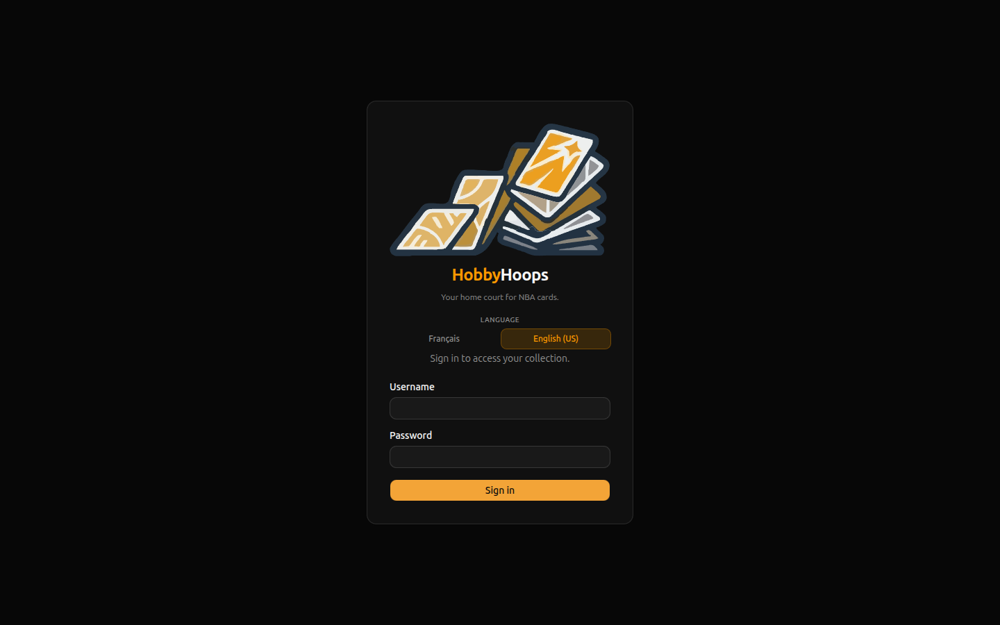
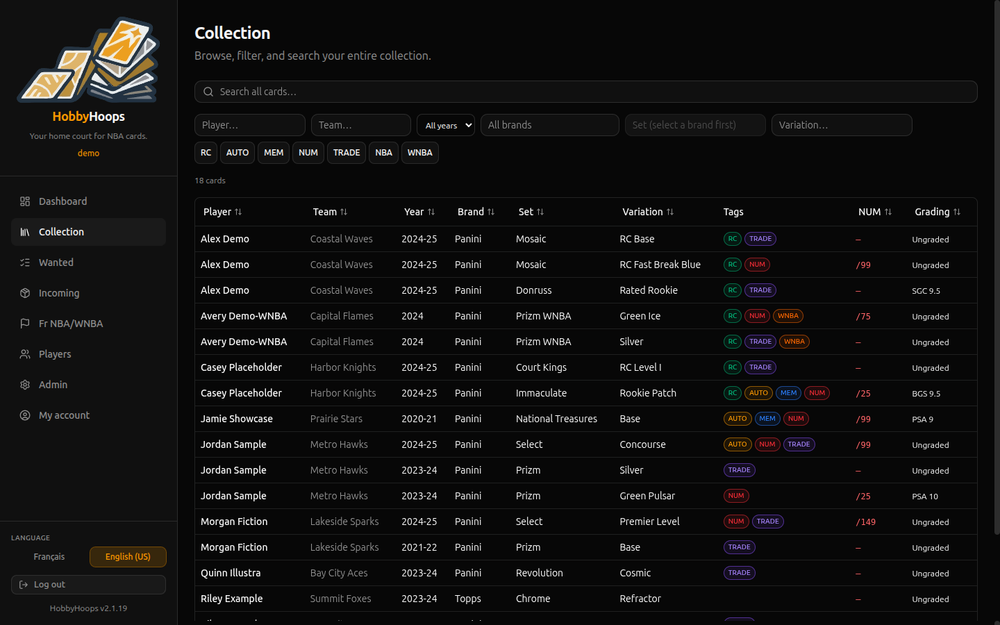
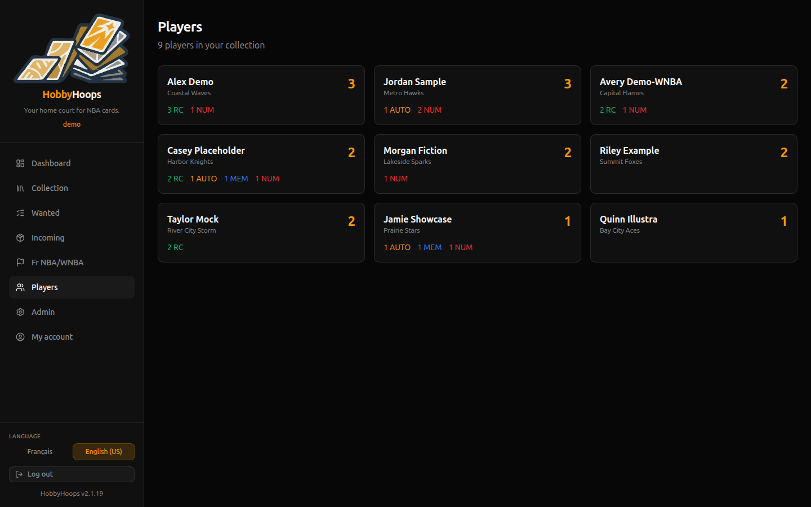
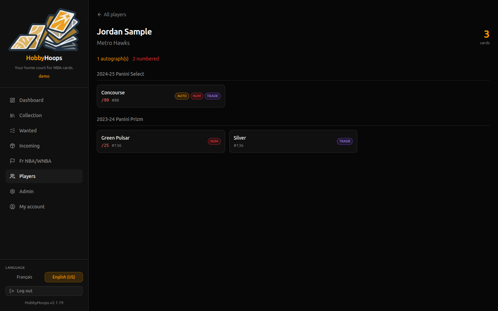
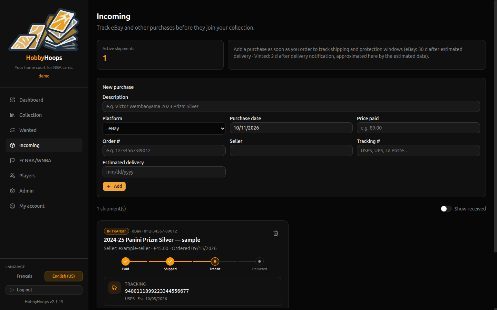
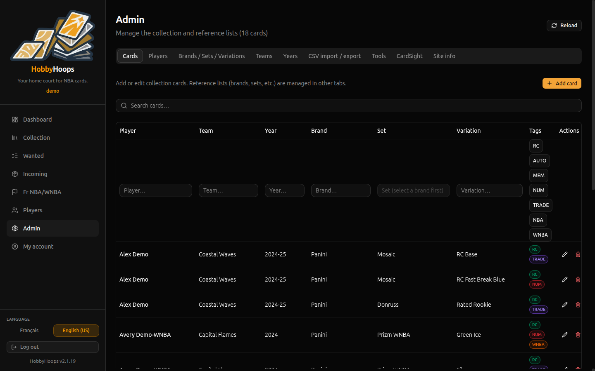
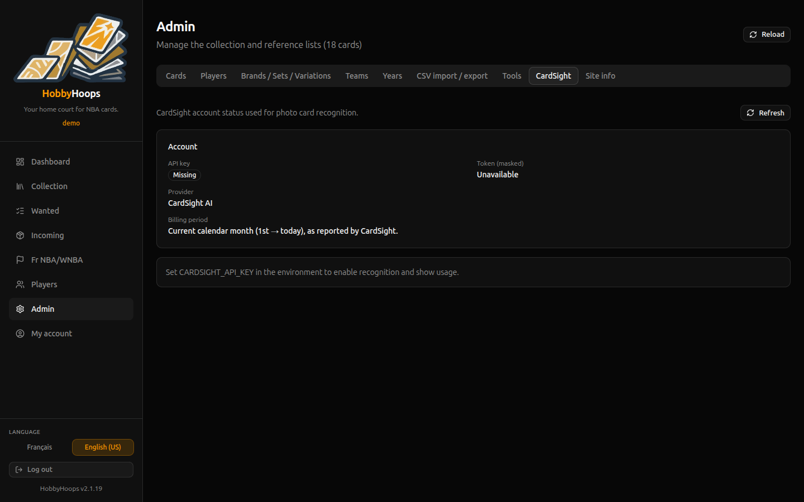

# HobbyHoops

Next.js app for managing an NBA card collection: browsing, players, admin, photo recognition (CardSight), and SQLite storage.



More detail (architecture, Docker production, CI, backups): [Wiki](https://github.com/mcinquin/hobbyhoops/wiki).

---

## Features

- **Dashboard** — totals, charts by brand/year/set, recent additions, incoming shipments
- **Collection** — filterable card grid with tags (RC, AUTO, MEM, NUM, TRADE, NBA/WNBA)
- **Players** — inventory per player, grouped by set and variation
- **Incoming** — track purchases before they join the collection
- **Admin** — cards and reference lists (brands, sets, variations, years, teams)
- **Card recognition** — analyze a photo (CardSight AI) to prefill year, brand, set, variation, and more
- **i18n** — French (default) and English (US)

---

## Screenshots

### Sign-in



### Dashboard


### Collection



### Players



### Player detail



### Incoming shipments



### Admin — cards



### Admin — CardSight



---

## Requirements

- Node.js 24 (see `.nvmrc`)
- npm

## Quick start (local)

```bash
cp .env.example .env.local
# Set AUTH_SECRET (openssl rand -hex 32)
npm ci
npm run dev
```

Open [http://localhost:3000](http://localhost:3000). On first launch, create the administrator account from the login screen.

Data lives in `data/` (SQLite + card photos). Do not commit it.

## Quick start (Docker, no reverse proxy)

For a simple local or LAN run over HTTP — no Apache/Nginx in front:

```bash
cp .env.example .env
# Required in .env:
#   AUTH_SECRET=<openssl rand -hex 32>
#   COOKIE_SECURE=false
#   TRUST_PROXY=false
mkdir -p data && sudo chown -R 1111:1111 data
docker compose -f docker-compose.dev.yml up --build -d
```

Open [http://127.0.0.1:3000](http://127.0.0.1:3000). Create the admin account on first visit.

`COOKIE_SECURE=false` is required on plain HTTP so the session cookie works. Production with HTTPS and a reverse proxy is documented in the [wiki](https://github.com/mcinquin/hobbyhoops/wiki/Docker).

## Documentation

| Topic | Where |
| ----- | ----- |
| Architecture, stack, features | [Wiki · Architecture](https://github.com/mcinquin/hobbyhoops/wiki/Architecture) |
| Docker / GHCR / reverse proxy | [Wiki · Docker](https://github.com/mcinquin/hobbyhoops/wiki/Docker) |
| SQLite, photos, backup / restore | [Wiki · Data and backup](https://github.com/mcinquin/hobbyhoops/wiki/Data-and-backup) |
| CSV import / export | [Wiki · CSV](https://github.com/mcinquin/hobbyhoops/wiki/CSV-import-export) |
| CI, releases, GHCR | [Wiki · CI and releases](https://github.com/mcinquin/hobbyhoops/wiki/CI-and-releases) |
| Scripts, quality, contributing | [Wiki · Development](https://github.com/mcinquin/hobbyhoops/wiki/Development) |
| Security | [SECURITY.md](SECURITY.md) · [Wiki · Security](https://github.com/mcinquin/hobbyhoops/wiki/Security) |
